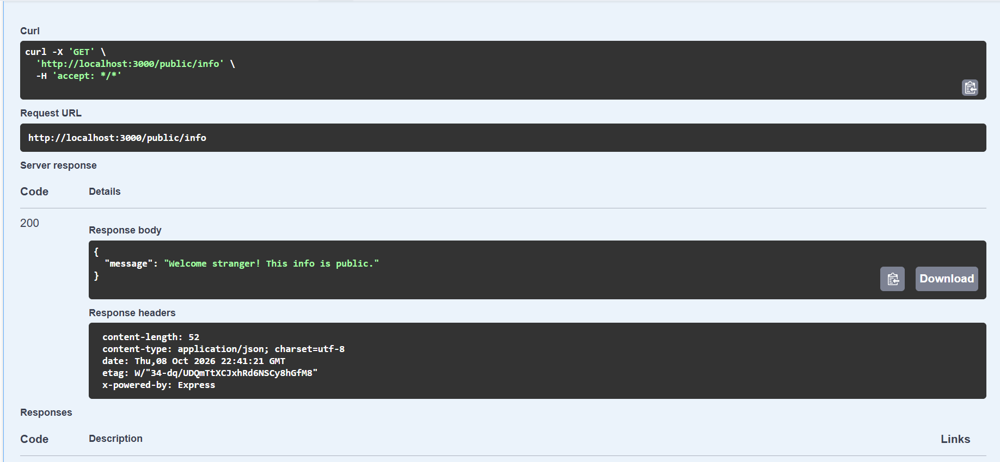

# Auth API (Supabase)

A secure Node.js and Express API that uses Supabase Auth as its Identity Provider. Users sign up and log in through Supabase, receive a JWT access token, and send it in the `Authorization` header to reach protected routes. The server never stores or hashes passwords.

## Setup
1. Create a free project at supabase.com.
2. In Project Settings > API, copy the **Project URL** and the **publishable (anon) key**. Never use the `service_role` key.
3. In Authentication > Sign In / Providers > Email, turn **Confirm email** off (practice project only).
4. Create your env file and fill it in:
   ```bash
   cp .env.example .env      # Windows PowerShell: Copy-Item .env.example .env
   ```
   | Variable | Meaning |
   |----------|---------|
   | SUPABASE_URL | Your Supabase project URL |
   | SUPABASE_KEY | Your Supabase publishable (anon) key |
   | PORT | Port for the server (default 3000) |

## Run
```bash
npm install
npm start
```
Server: http://localhost:3000 and Swagger UI: http://localhost:3000/docs

## API reference
| Method | Path | Auth needed | Success | Errors |
|--------|------|-------------|---------|--------|
| POST | /auth/signup | No | 201 | 400 |
| POST | /auth/login | No | 200 | 400, 401 |
| POST | /auth/logout | Yes (Bearer token) | 204 | 401 |
| GET | /protected/profile | Yes (Bearer token) | 200 | 401 |
| GET | /protected/dashboard | Yes (Bearer token) | 200 | 401 |
| GET | /public/info | No | 200 | |

## How the auth check works
`auth.js` holds one reusable middleware, `requireAuth`. It reads the `Authorization: Bearer <token>` header, asks Supabase to verify the token with `supabase.auth.getUser(token)`, and attaches the user to `req.user`. A missing or malformed header returns `401 Access token required`. An invalid or expired token returns `401 Invalid or expired token`. The same middleware guards `/protected/profile`, `/protected/dashboard` and `/auth/logout`, so no auth code is repeated.

## Try it with curl
```bash
curl -i -X POST http://localhost:3000/auth/signup -H "Content-Type: application/json" -d '{"email":"you@gmail.com","password":"password123"}'
curl -i -X POST http://localhost:3000/auth/login  -H "Content-Type: application/json" -d '{"email":"you@gmail.com","password":"password123"}'
curl -i http://localhost:3000/protected/profile -H "Authorization: Bearer <ACCESS_TOKEN>"
```
(On Windows PowerShell use `curl.exe` and escape the JSON quotes as `\"`.)

Example output:
```
HTTP/1.1 200 OK
Content-Type: application/json; charset=utf-8

{"id":"e9c52623-f62a-47e6-8a2d-618a278b6fdb","email":"abeerahateeq@gmail.com","created_at":"2026-10-08T22:32:36.193365Z"}
```

## Swagger UI


## Security notes
- `.env` is git-ignored and was never committed. Only `.env.example` is in the repo.
- Only the public publishable (anon) key is used. The `service_role` key is never used.
- Passwords are only forwarded to Supabase. This server never stores or hashes them.
- Logout calls Supabase's logout endpoint with the caller's token. Because JWTs are stateless, an already issued access token may still pass verification until it expires, depending on Supabase settings.
